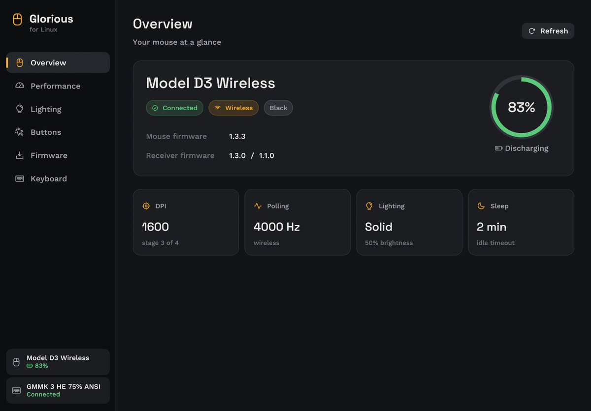
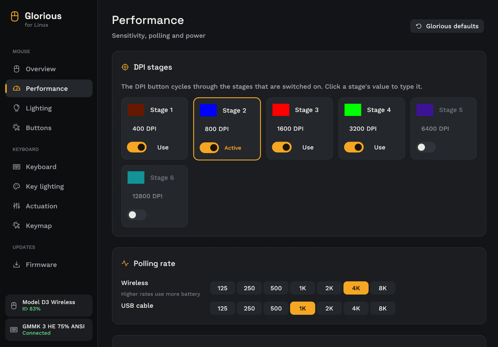
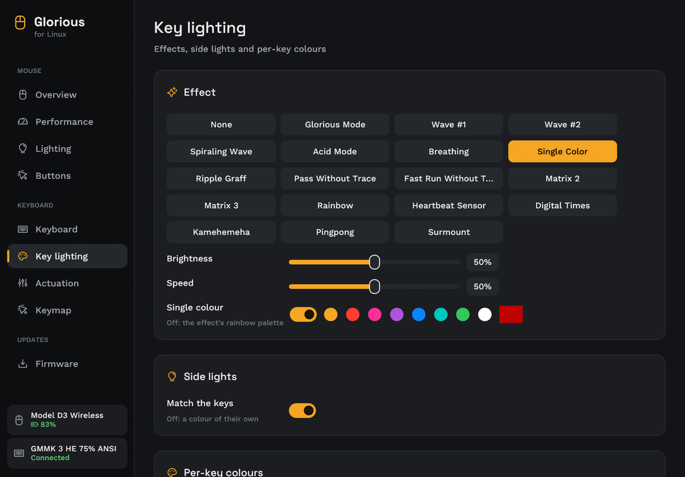
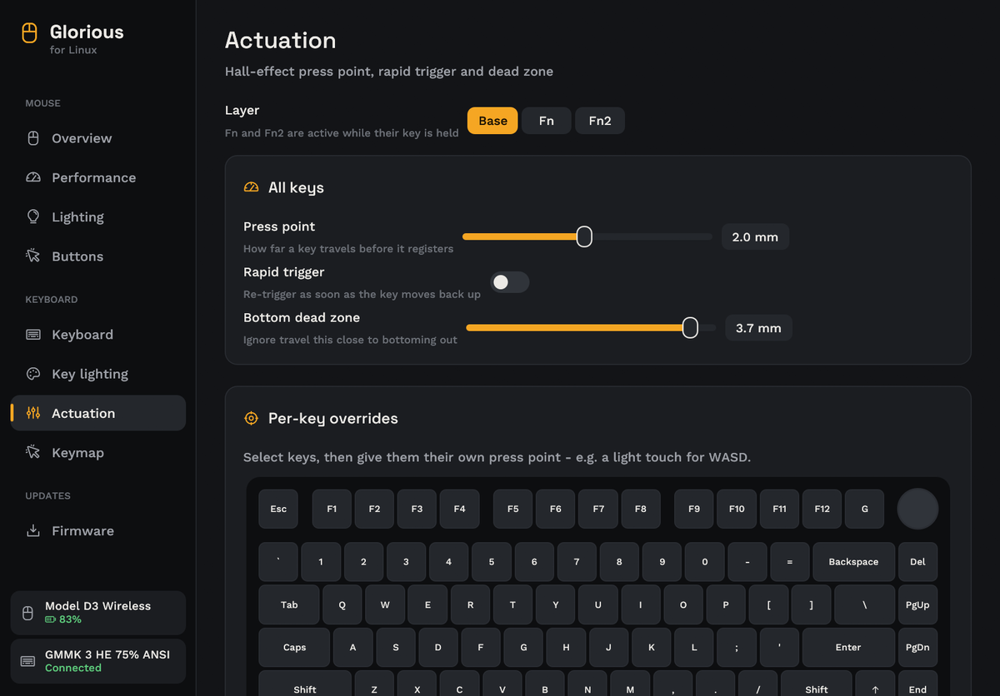
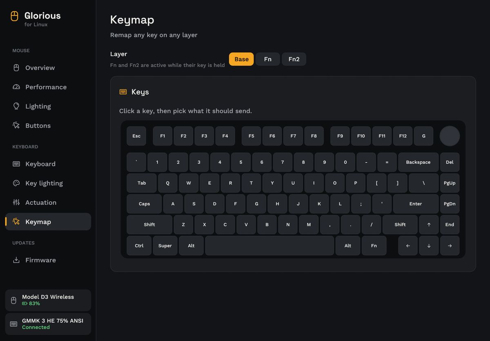

<div align="center">


# Glorious for Linux

**Settings, lighting, keymaps and firmware updates for Glorious mice and keyboards - no Glorious CORE, no Windows.**

[](https://github.com/Virel0/glorious-linux/actions/workflows/ci.yml)
[](https://github.com/Virel0/glorious-linux/releases/latest)
[](LICENSE)


[Install](#install) · [Features](#features) · [Firmware updates](#firmware-updates) · [Troubleshooting](#troubleshooting) · [Security](SECURITY.md) · [Changelog](CHANGELOG.md)



</div>

> **Unofficial.** Not affiliated with or endorsed by Glorious. Use at your own risk.

## Features

<table>
<tr>
<td width="50%" valign="top">

### 🖱️ Mouse
- Reads the mouse's real settings - nothing to set up first
- Battery, firmware and connection at a glance
- Six DPI stages with colours; the active stage **follows the DPI button live**
- Polling rate (125 - 8000 Hz), lift-off, motion sync, debounce, sleep timer
- 12 lighting effects with an animated preview
- Remap any button to a mouse function or a key

</td>
<td width="50%" valign="top">

### ⌨️ Keyboard
- Profiles, polling rate, debounce, idle timeout
- 19 lighting effects, side lights, and **per-key colours painted on the board**
- Hall-effect press point, rapid trigger, dead zone and per-key overrides
- Keymap for the Base, Fn and Fn2 layers

### ⬆️ Firmware
- Checks mouse, receiver and keyboard against Glorious' latest release
- Updates the mouse and receiver natively, with a dry run and progress bars

</td>
</tr>
</table>

<table>
<tr>
<td></td>
<td></td>
</tr>
<tr>
<td></td>
<td></td>
</tr>
</table>

## Supported devices

| Device | USB ID | Status |
|---|---|---|
| Model D3 Wireless (receiver or cable) | `3794:a300` / `3794:a322` | ✅ Settings, live DPI, firmware update tested |
| Model O3 Wireless | `3794:a300` / `3794:a310` | 🟡 Same protocol, untested |
| GMMK 3 HE 75% ANSI | `342d:e3de` | ✅ Reads tested · lighting / actuation tested upstream · keymap is new |

Have another Glorious device? See [CONTRIBUTING.md](CONTRIBUTING.md) - most of the work is
already done.

## Install

**One line** - builds from source if you have Rust, otherwise downloads the release binary and
checks its checksum:

```sh
curl -fsSL https://raw.githubusercontent.com/Virel0/glorious-linux/main/install.sh | bash
```

**From a clone** (read the script first if you prefer):

```sh
git clone https://github.com/Virel0/glorious-linux && cd glorious-linux && ./install.sh
```

**Arch / CachyOS / Manjaro** - a proper package with everything system-wide:

```sh
git clone https://github.com/Virel0/glorious-linux && cd glorious-linux/packaging/arch && makepkg -si
```

The installer puts `glorious` in `~/.local/bin` and **Glorious** in your app menu, then asks
once for `sudo` to install the [udev rule](SECURITY.md#what-the-app-can-touch) (device access
for your user) and `dfu-util` (used for the receiver's USB chip; everything else is built in).
Unplug and replug your devices afterwards. `./uninstall.sh` removes it again.

## Usage

Open **Glorious** from your app menu, or run `glorious`. Everything is also scriptable:

```sh
glorious mouse info                    # status and every setting the mouse reports
glorious mouse dpi 400,800,1600,3200 --active 3 --colors ff0000,00ff00,0000ff,ffffff
glorious mouse polling 4000            # wireless; add --wired for the cable rate
glorious mouse liftoff 1               # 0.7 | 1 | 2 (mm)
glorious mouse motion-sync on
glorious mouse debounce --mechanical 2 --optical 0
glorious mouse sleep 10                # minutes, 0 = never
glorious mouse lighting solid --color ff8800 --brightness 60
glorious mouse bind dpi middle         # or key:a, key:f12, key:0x04 ...
glorious mouse firmware check
glorious mouse firmware flash --dry-run
glorious keyboard info
```

Add `-v` to see every HID report sent and received.

## Firmware updates

Updates use Glorious' own firmware, downloaded from the same server Glorious CORE uses and
checked against a pinned SHA-256 before anything is flashed. The mouse must be on its USB cable;
the app refuses otherwise. An update runs in up to three steps:

1. **Mouse** - reboots into its nRF52 bootloader; the built-in Nordic DFU client sends the
   signed image in CRC-checked pieces.
2. **Receiver radio** - the same, through the receiver's nRF52 bootloader.
3. **Receiver USB chip** - reboots into the GD32 ROM bootloader and is flashed with `dfu-util`.

The nRF52 bootloaders keep the old firmware until a complete, verified image has arrived, so an
interrupted update can simply be run again. Try the **dry run** first to see every step.
Reinstalling the current mouse firmware has been tested on a Model D3.

GMMK 3 HE keyboard updates still need Glorious CORE on Windows; the Firmware page tells you when
one is available.

## Troubleshooting

<details>
<summary><b>"No reply from the mouse"</b></summary>

The mouse is asleep. Move it - the app reconnects on its own within a few seconds.
</details>

<details>
<summary><b>"Permission denied" / device not found</b></summary>

Run the installer again and let it install the udev rule, then unplug and replug the device.
</details>

<details>
<summary><b>The keyboard shows "Connecting…" for a few seconds</b></summary>

Normal: the first read from the keyboard takes about 3.5 seconds. The pages show your saved
settings meanwhile; applying waits until the keyboard answers.
</details>

<details>
<summary><b>The taskbar shows a generic icon</b></summary>

Log out and back in once - KDE and GNOME cache icon lookups per session.
</details>

<details>
<summary><b>Where are the keyboard settings stored?</b></summary>

The keyboard can't report its lighting, actuation or keymap, so - like Glorious CORE - the last
applied values are kept in `~/.config/glorious-core-rs/state.json`, shared with
[inglorious-core-linux](https://github.com/tg5ee/inglorious-core-linux). Mouse settings are read
from the mouse itself.
</details>

## How it works

The protocols were re-implemented for interoperability from Glorious CORE 2.1.23 (an Electron
app whose device logic is plain JavaScript) and checked against real hardware:

- **Mouse** - 64-byte HID feature reports with report ID 3: `[0x03, target, command, length,
  payload…]`, where target `0xBB` is the mouse (relayed over 2.4 GHz by the receiver) and `0xAA`
  the receiver. Every setter has a getter at `command | 0x80`, which is how settings are read back.
- **Keyboard** - the protocol and state code of
  [inglorious-core-linux](https://github.com/tg5ee/inglorious-core-linux), pinned to a commit
  whose reports were checked against Glorious CORE.
- **Firmware** - CORE's updaters are packaged Node.js programs; their exact HID commands were
  captured by running them against a mocked HID layer. The Nordic DFU client is our own, tested
  against a simulated bootloader and on real hardware.

No Glorious code, binaries or firmware are included in this repository.

## Credits

- [inglorious-core-linux](https://github.com/tg5ee/inglorious-core-linux) (MIT) - keyboard
  protocol library and board layout
- Space Grotesk, Work Sans and JetBrains Mono fonts (SIL Open Font License, see `assets/fonts`)
- [Phosphor](https://phosphoricons.com) icons (MIT, bundled in `assets/fonts`), built with [egui](https://github.com/emilk/egui)

## License

Copyright © 2026 Virel0. Licensed under the [GNU General Public License v3.0 or later](LICENSE):
anyone may use, study, change and share it, including commercially, but copies and modified
versions they distribute must stay under the GPL with their source available, and devices that
ship it can't be locked against running modified versions.

Releases up to v0.3.0 were published under the MIT license. The keyboard protocol code in
`src/magneton`, the board layout in `src/keybed.rs` and the keyboard I/O in `src/kbdevice.rs` come
from inglorious-core-linux and keep its MIT notice.
